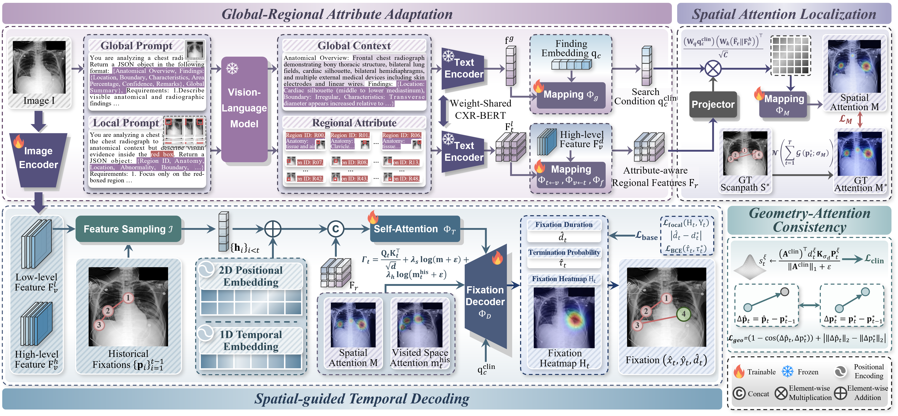

# GRAD: Global-Regional Attribute Adaptation and Spatio-Temporal Decoding with Vision-Language Models for Radiology Scanpath Prediction

GRAD is a radiology scanpath prediction framework that combines hierarchical clinical semantics, task-relevant spatial localization, and progressive temporal decoding.



**GRAD overview.** Global-Regional Attribute Adaptation incorporates global context and regional attribute to construct image-specific search conditions and attribute-aware regional features. Spatial-guided Temporal Decoding estimates a task-relevant spatial prior for progressive trajectory generation, while Geometry-Attention Consistency regularizes attention allocation and inter-fixation geometry.

## Abstract

Radiology scanpath prediction aims to model the dynamic visual search behavior of radiologists during diagnostic reasoning. Radiological abnormalities often exhibit low contrast and subtle visual manifestations, making the detailed clinical descriptions provided by vision-language models (VLMs) a valuable complement to visual representations. However, existing methods insufficiently characterize fine-grained radiographic attributes, while accurate prediction requires jointly modeling abnormality localization and the spatiotemporal dynamics of visual attention. We propose GARD, a Global-Regional Attribute-aware Spatio-Temporal Decoding framework for radiology scanpath prediction. Global-regional attribute adaptation leverages VLMs to obtain global context and regional attributes to construct an image-specific search condition and attribute-aware regional features, respectively. Spatial-guided temporal decoding estimates a task-relevant spatial attention distribution as a prior for progressive trajectory generation. Finally, geometry-attention consistency regularizes attention allocation and fixation geometry to encourage coherent scanpaths. GARD achieves state-of-the-art performance on the GazeSearch benchmark, with a ScanMatch score of 0.3942. Downstream disease classification on SIIM-ACR and TB-MOUSE further demonstrates that GARD-predicted gaze provides effective task-relevant information..

## Qualitative Visualization


**Predicted scanpaths on GazeSearch.** GRAD concentrates fixations on diagnostically relevant regions and produces transitions that more closely follow radiologist scanpaths than the comparison methods.

## Repository Structure

```text
GRAD/
├── Data/
│   ├── Text/<image-id>/
│   │   ├── global.json
│   │   └── local.json
│   ├── dataset.py
│   └── finding_visual_search_..._shuffled.json
├── method/
│   ├── model/
│   ├── utils/
│   ├── dataset_gaze.py
│   ├── train.py
│   └── test.py
├── assets/
├── requirements.txt
└── README.md
```

## Data Preparation

### Dataset Links

The datasets used in our experiments can be accessed from the following sources:

* **GazeSearch**: [Official Repository](https://github.com/UARK-AICV/GazeSearch) | [Hugging Face Dataset](https://huggingface.co/datasets/phamtrongthang/GazeSearch)
* **SIIM-ACR Pneumothorax Segmentation**: [Kaggle Dataset](https://www.kaggle.com/c/siim-acr-pneumothorax-segmentation/data)

The original GazeSearch split annotation and the global/local clinical descriptions are included under `Data`. The global and local clinical text descriptions used by HiSTAR can also be downloaded from [Google Drive](https://drive.google.com/drive/folders/1itARcZuYHQi3JsVJ3S3g-t7t_5V4sSd1?usp=sharing) and should be placed under:

```text
Data/Text/
```

Download the GazeSearch images separately and retain the filenames used by the annotation file:

```text
Data/images/
```

> **Note:** Part of the GazeSearch image data is derived from MIMIC-CXR. Access to the corresponding images may therefore require authorized access to MIMIC-CXR through PhysioNet.

Clinical descriptions are encoded lazily with `microsoft/BiomedVLP-CXR-BERT-specialized`. The model is downloaded on first use unless `--text-model` points to a local model directory. Finding-specific attention supervision is reconstructed only from records belonging to the active split.

## Installation

Python 3.10 or later is recommended.

```bash
pip install -r requirements.txt
```

## Training

Run commands from the `GRAD` directory:

```bash
python method/train.py
```

Only the training split is passed to the optimizer. The validation split is used for validation loss, checkpoint selection, learning-rate scheduling, and early stopping. The test split is not loaded by the training entry point.

Useful options include:

## Evaluation

Evaluate the held-out test split with:

```bash
python method/test.py \
  --data-root Data \
  --checkpoint method/output/experiment_TIMESTAMP/checkpoint_best.pth \
  --split test
```

The evaluation script reports the ScanMatch, MultiMatch, SED, and STDE metrics and writes predictions, per-sample measurements, attention maps, and scanpath visualizations to the checkpoint directory or the directory specified by `--output-dir`.

